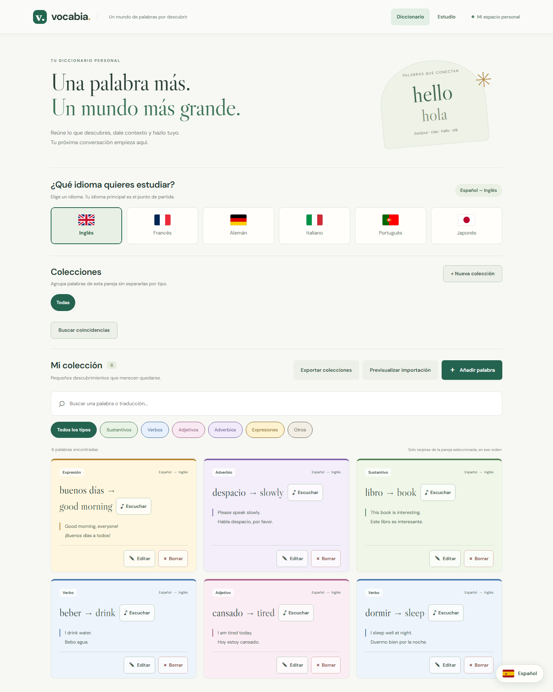

# Vocabia

**Diccionario personal multilingüe para guardar vocabulario y practicar idiomas.** Es un MVP local de aprendizaje y portfolio, desarrollado con React, TypeScript, Express y PostgreSQL/PGlite. Permite organizar palabras por pareja de idiomas y colección, añadir ejemplos, buscar, importar y exportar, y estudiar con ejercicios escritos y de escucha.



[Ver también la pantalla de Estudio](docs/screenshots/estudio.png). Las capturas usan una base temporal con datos ficticios; no muestran vocabulario personal.

### Pruébalo en local

Necesitas Node.js 22.12 o posterior y npm. Desde la raíz del repositorio:

```powershell
npm ci
npm run dev
```

Abre `http://localhost:5173`. Se inicia sin cuenta ni servidor PostgreSQL instalado: PGlite guarda los datos en `backend/data/`, ignorado por Git. Para comprobar el código, ejecuta `npm test`, `npm run typecheck` y `npm run build`. [Instalación detallada](#instalar-y-ejecutar) · [Pruebas](#comprobar-el-proyecto).

**Estado:** el código y la base local funcionan; todavía no hay despliegue público, cuentas ni sincronización entre dispositivos. Los planes para dictar tarjetas y crear un tutor de IA están descritos en [Siguientes etapas](#siguientes-etapas-sin-implementar); aún no forman parte de la aplicación. La API actual está pensada para un solo usuario local.

## Estado inicial y decisiones

La carpeta estaba vacía, sin archivos, configuración ni repositorio Git. No se sobrescribieron archivos existentes.

- **React + TypeScript:** componentes para la interfaz y tipos para detectar errores durante el desarrollo.
- **Vite:** servidor de desarrollo y compilación del frontend.
- **Node.js + Express + TypeScript:** API HTTP pequeña con validaciones mediante Zod.
- **PostgreSQL:** SQL explícito con consultas parametrizadas. Con `DATABASE_URL` se conecta a un servidor con `pg`.
- **PGlite para arrancar localmente:** PostgreSQL integrado en Node que persiste en `backend/data/`. Evita exigir un servidor instalado para probar el MVP. Los tests de API ejecutan SQL real en PGlite en memoria; no sustituyen la verificación con un servidor PostgreSQL independiente.
- **Vitest + Testing Library + Supertest:** pruebas del formulario y de la API con su base de datos.
- **npm workspaces:** frontend y backend son paquetes separados y comparten una instalación desde la raíz. No se añade una herramienta de monorepo.

Referencia: [Vite](https://vite.dev/guide/) y [PGlite](https://pglite.dev/docs/).

## Qué incluye el MVP

- Lista, creación, edición y borrado con confirmación.
- Palabra o expresión, traducción, idiomas distintos, tipo, notas opcionales y entre 1 y 10 ejemplos, cada uno con una traducción opcional.
- Para verbos traducidos al inglés: pasado simple, participio pasado y forma en `-ing`, todos opcionales.
- Búsqueda en palabra y traducción, sin distinguir mayúsculas. No elimina diferencias de acentos.
- Colección limitada a la pareja exacta de idiomas seleccionada, combinable con búsqueda y filtro por tipo.
- Colecciones personalizadas, por ejemplo «A1» o «Importantes», para reunir palabras de distintos tipos dentro de esa pareja.
- Exportación JSON de la colección completa para conservar una copia del vocabulario.
- Importación de un JSON exportado, con vista previa, comparación de coincidencias y confirmación antes de guardar.
- Búsqueda de posibles coincidencias entre tarjetas de distintas colecciones de la pareja seleccionada, sin cambios automáticos.
- Práctica básica: preguntas mezcladas por rondas sobre traducciones, formas inglesas y ejemplos traducidos, con respuesta oculta y opción de escribirla. Puedes marcar cada palabra como conocida o difícil y repasar solo las difíciles de los filtros actuales. Historial de las últimas cinco rondas por pareja de idiomas.
- Interfaz traducida a los siete idiomas disponibles, adaptable a móvil, con diálogos nativos y etiquetas de formulario. Las tarjetas conservan su contenido y sus etiquetas.
- Navegación entre **Diccionario** (`/`) y **Estudio** (`/estudio`), con enlaces directos y botones atrás/adelante del navegador.
- Estados de carga, colección vacía, errores y mensajes de éxito.
- Seis entradas ficticias de demostración, cargadas una sola vez. Borrarlas no las repone al reiniciar.
- Idiomas iniciales: español, inglés, francés, alemán, italiano, portugués y japonés. Se pueden añadir más ampliando los catálogos del backend y frontend.

La aplicación permite guardar palabras repetidas: una misma palabra puede tener distintos significados o contextos. Las formas inglesas se guardan manualmente y ya pueden practicarse. El historial conserva totales por ronda. La marca «La sabía» o «Me costó» es una valoración personal de la tarjeta; no califica respuestas alternativas ni calcula un nivel de dominio.

### Dos espacios de trabajo

**Diccionario** reúne la presentación, los idiomas, las colecciones, las coincidencias, la búsqueda y las tarjetas para añadir, editar, borrar, importar y exportar. **Estudio** muestra la pareja de idiomas, un selector sencillo de colección, los botones de práctica y las rondas recientes. La pareja y la colección elegidas se conservan al cambiar de sección durante la sesión; la búsqueda y el tipo del Diccionario no limitan los ejercicios. La cabecera permanece visible al desplazarse; al cambiar de sección desde ella, la nueva vista comienza arriba. Las URLs `/` y `/estudio` funcionan con atrás/adelante. En desarrollo, Vite sirve ambas rutas; al desplegar una SPA, el servidor deberá servir `index.html` también para `/estudio`.

Comprobación en Chrome con una base PGlite temporal: la navegación entre ambas rutas funcionó, A1 limitó la práctica a sus palabras y `/estudio` abrió directamente al recargar. A 375 px la página no tuvo desplazamiento horizontal y se revisó una captura de la cabecera móvil. Las pruebas de interfaz comprueban además los botones atrás/adelante. Sigue pendiente configurar la ruta directa en el servidor de un futuro despliegue.

### Colecciones personalizadas

**Tipo de palabra** describe qué es una entrada (verbo, adjetivo…). Una **colección** es una agrupación que eliges tú: «A1» puede contener `dormir → sleep` y `cansado → tired` aunque tengan tipos distintos. La misma tarjeta puede estar también en «Importantes», sin duplicar sus datos.

Selecciona una pareja, pulsa **Nueva colección**, escribe el nombre y créala. Con la colección seleccionada, usa **Añadir palabra existente** para incorporar tarjetas de esa pareja. Si pulsas **Añadir palabra** y mantienes esa pareja de idiomas en el formulario, la nueva tarjeta entra directamente en la colección y también aparece en **Todas**. Si cambias su pareja en el formulario, se guarda en la pareja nueva, fuera de la colección actual. El selector **Todas** muestra de nuevo todas las tarjetas. La búsqueda y el filtro por tipo siguen funcionando dentro de la colección. Al pasar a **Estudio**, se conserva la colección seleccionada, pero allí se eligen las colecciones sin controles de creación o borrado. **Quitar de la colección** desvincula una tarjeta, pero la deja en **Todas**. **Eliminar colección** pide confirmación y conserva todas sus palabras.

Cada colección pertenece a una pareja ordenada: Español → Inglés y Alemán → Inglés tienen colecciones diferentes. Los nombres se pueden repetir en parejas distintas, pero no dos veces en la misma pareja aunque cambies mayúsculas. Por ahora no se pueden renombrar colecciones. El nivel «A1» es solo un nombre que pones tú; la aplicación no asigna niveles automáticamente.

Debajo de las colecciones, **Buscar coincidencias** consulta las tarjetas de la pareja seleccionada y agrupa las que tienen la misma palabra y traducción, sin distinguir mayúsculas ni espacios al principio o al final. Muestra a qué colecciones pertenece cada tarjeta, sus notas y sus ejemplos. Por ejemplo, `dormir → sleep` puede aparecer en A1 y A2 con frases distintas. La coincidencia es una pista, no una orden para fusionar: tampoco considera equivalentes traducciones diferentes. Una misma tarjeta puede estar vinculada a ambas colecciones sin duplicarla; la importación de tarjetas separadas también puede dejar dos registros coincidentes.

Pulsa **Preparar fusión** dentro de un grupo. Elige la **tarjeta A**, que sirve de base e identifica el resultado, y la **tarjeta B**, que se incorporará. Compara sus datos completos en dos columnas: palabra, traducción, colección, tipo, ejemplos, notas y, si corresponde, formas verbales. La tercera columna es la **vista previa editable** de la tarjeta resultante. Los ejemplos de B se pueden arrastrar a una posición del resultado o incorporar con **Añadir**, que funciona en móvil y con teclado; también puedes quitarlos o reordenarlos. Las notas y cada forma verbal se editan en la vista previa. La tarjeta resultante reúne las colecciones de ambas.

**Unir ambas en el resultado** añade de una vez los ejemplos distintos y las notas de las dos tarjetas, y toma cada forma verbal disponible. Si una forma tiene valores diferentes, conserva inicialmente el de la primera tarjeta y avisa para que lo revises. También marca la eliminación de la segunda tarjeta, pero no guarda nada hasta que confirmes. Si la unión supera el máximo de 10 ejemplos o 2000 caracteres de notas, se detiene y tendrás que elegir el contenido manualmente.

**Revisar antes de guardar** muestra una confirmación. Si preparas la fusión manualmente, la segunda tarjeta se conserva por defecto: la primera recibe los datos elegidos y se vincula a las colecciones de ambas. Si marcas **Eliminar la segunda tarjeta después de fusionar** o pulsas **Unir ambas en el resultado**, se borrará solo al confirmar; cualquier ejemplo, nota o forma de esa segunda tarjeta que no hayas elegido dejará de estar disponible. El servidor comprueba que ambas tarjetas sigan teniendo la misma pareja, palabra y traducción y guarda la actualización, las relaciones y la posible eliminación en una **transacción**: si falla una parte, se revierte todo.

Después de fusionar, **Deshacer última fusión** aparece en **Buscar coincidencias** para esa pareja de idiomas. Recupera el contenido y las colecciones originales de ambas tarjetas; si B se había eliminado, vuelve con su mismo identificador. El historial queda en la base de datos local, por lo que el botón sigue disponible tras reiniciar. El servidor rechaza la recuperación si una de las tarjetas cambió después o si falta alguna colección original: así no pisa trabajo posterior. Una fusión deshecha no se puede volver a deshacer. La migración `006_merge_history.sql` crea la tabla de historial al arrancar; no cambia las tarjetas actuales. La exportación JSON de vocabulario no incluye este historial, así que conviene conservar una copia de los datos importantes antes de importar o cambiar de equipo.

La migración `004_collections.sql` añade `collections` y `collection_words`. Esta segunda tabla guarda la relación entre tarjetas y colecciones; una tarjeta puede aparecer en varias. Al borrar una tarjeta se limpian sus relaciones; al cambiar sus idiomas, se retira de las colecciones de la pareja anterior. La migración no modifica las palabras existentes. Antes de actualizar una base con datos importantes, conserva una copia de `backend/data/` con el servidor detenido.

Al crear una palabra desde una colección, la API recibe su `collectionId` opcional. Comprueba que exista y que coincidan ambos idiomas. La palabra y su pertenencia se insertan en una sola instrucción SQL: si la colección ya no existe o la pareja no coincide, no se guarda una palabra suelta por accidente. Crear desde **Todas** sigue usando la petición de siempre.

**Qué conviene entender:** la palabra y la colección viven en tablas distintas. `collection_words` guarda pares de identificadores para relacionarlas; por eso una palabra puede estar en «A1» y «Importantes» a la vez. El filtro de colección se suma a los de búsqueda y tipo: las condiciones deben cumplirse juntas. El frontend solicita los datos a la API y muestra el resultado, mientras la base mantiene la pertenencia aunque cierres la página.

### Primeras formas de verbos ingleses

Si una tarjeta tiene **tipo Verbo** e **idioma de la traducción Inglés**, el formulario ofrece tres campos opcionales. La traducción principal sigue siendo la forma base. Por ejemplo, `dormir → sleep` puede guardar pasado simple `slept`, participio pasado `slept` y forma `-ing` `sleeping`. Solo aparecen en la tarjeta los campos rellenos. El programa no los calcula ni los consulta en Internet: debes comprobar que los escribes correctamente.

`sleeping` es la forma en `-ing`; un presente continuo completo necesita también sujeto y auxiliar, por ejemplo `I am sleeping`. Esta distinción evita etiquetar incorrectamente una forma aislada como una oración completa. Si cambias el tipo de la tarjeta o su idioma de traducción y guardas, las formas inglesas se vacían porque ya no corresponden a ese registro. Si vuelves a seleccionar Verbo e Inglés **antes de guardar**, lo escrito en el formulario sigue disponible.

La migración `003_english_verb_forms.sql` añade una columna JSONB con un objeto vacío como valor inicial. Conserva palabras, ejemplos, notas e identificadores existentes. Se ejecuta al arrancar y es repetible; registra su nombre en `app_migrations`. A diferencia de la conversión anterior, la creación de la columna y el registro son dos instrucciones: si falla el registro, el siguiente arranque vuelve a comprobar la columna y lo completa. La API acepta peticiones antiguas sin las formas; al editar un verbo inglés así, conserva sus formas existentes. Cada valor se limita a 120 caracteres y el backend rechaza formas rellenas en otros tipos o idiomas.

Para probarlo: crea `dormir → sleep`, selecciona **Verbo** e **Inglés** como idioma de traducción, rellena `slept`, `slept` y `sleeping`, guarda y vuelve a abrir la tarjeta. Comprueba también que un sustantivo o una traducción a francés no muestra esos campos. Las pruebas automatizadas usan PGlite en memoria; no se ha probado todavía la migración contra un servidor PostgreSQL independiente ni se ha hecho revisión visual de estos campos en navegador.

### Tarjetas, filtros y práctica

La palabra y su traducción tienen ahora un tamaño parecido y una flecha muestra la dirección, por ejemplo **dormir → sleep**. Los filtros de tipo usan los mismos colores que las tarjetas. El filtro seleccionado se distingue también por su relleno y por `aria-pressed`; el nombre del tipo sigue visible. Los botones **Editar** y **Borrar** incluyen texto, un símbolo y una zona de pulsación mayor. El borrado conserva su confirmación.

Junto a la traducción de cada tarjeta aparece **Escuchar**. En `dormir → sleep` se pronuncia `sleep` con el idioma de estudio; no se reproduce `dormir`. El botón usa la misma función de voz que el ejercicio de escucha (`speech.ts`) y deja de estar disponible si el navegador no ofrece esa función. La aplicación no guarda ningún archivo de audio. La voz concreta y su calidad dependen del navegador y del sistema.

Entra en **Estudio** y pulsa **Practicar** cuando haya palabras en la pareja y colección seleccionadas. La búsqueda y el tipo que dejaste en Diccionario no afectan a esta ronda. Cada tarjeta aporta una pregunta por su traducción principal. Si es un verbo traducido al inglés, aporta además una pregunta por cada forma guardada: pasado simple, participio pasado y forma `-ing`. Un verbo antiguo sin formas sigue aportando solo la pregunta de traducción. Las preguntas se mezclan al comenzar cada ronda y no se repite ninguna pregunta dentro de ella. Una misma palabra puede aparecer varias veces con etiquetas distintas. Piensa la respuesta y elige **Mostrar respuesta** o **Escribir respuesta**. Después pasa a la siguiente pregunta; al terminar pulsa **Ver resumen** y desde allí puedes iniciar **Nueva ronda**, con otra mezcla. **Volver a Estudio** muestra de nuevo las opciones y el historial. Por ejemplo, `dormir → sleep` con `slept` y `sleeping` guardados produce tres preguntas: traducción, pasado simple y forma `-ing`.

**Escuchar y elegir** es un ejercicio aparte. Pulsa **Escuchar palabra** para oír la traducción en el idioma de estudio y elige entre las palabras de tu idioma de referencia. Cada pregunta ofrece hasta cuatro opciones de la pareja y colección seleccionadas; se necesitan al menos dos palabras distintas. Se omiten palabras cuyo audio u opción coincida con otra tarjeta, para evitar preguntas con dos respuestas correctas. Al elegir, se muestra la respuesta y al final aparece el número de aciertos. Este resultado todavía no se guarda en el historial de rondas. Vocabia pide la voz al navegador: su disponibilidad, acento, calidad y posible procesamiento externo dependen del navegador y del sistema. Vocabia no usa micrófono, cuenta externa ni servicio de IA para este ejercicio. Para probarlo, añade `dormir → sleep`, `beber → drink` y otras dos palabras en Español → Inglés, entra en **Estudio**, pulsa **Escuchar y elegir** y comprueba que el audio y las opciones corresponden a esa pareja. Si eliges una colección, solo entran sus palabras.

**Hablar y comprobar** practica la otra dirección: muestra `dormir`, pulsas **Hablar** y dices `sleep`. El navegador pide permiso para el micrófono y devuelve el texto que entendió; Vocabia lo compara con la traducción guardada, ignorando mayúsculas, espacios sobrantes y puntuación final. Si el texto reconocido no coincide, muestra qué entendió el navegador y permite **Hablar de nuevo** sin contar aún la pregunta; también puedes mostrar la respuesta y pasar a la siguiente. No se elige una palabra entre las sugerencias del navegador. Una coincidencia **no mide la calidad de la pronunciación**: el reconocedor puede entender una palabra mal pronunciada o fallar con una pronunciación válida. Si no reconoce nada, puedes intentarlo de nuevo o mostrar la respuesta. El resultado se queda en la ronda de esa pantalla; Vocabia no guarda audio ni transcripciones ni los añade al historial. Algunos navegadores no admiten esta API y otros pueden procesar el audio en un servicio externo del navegador. La página avisa de ello antes de activar el micrófono. Para probarlo, entra en **Estudio → Hablar y comprobar**, acepta el permiso y di una traducción de una tarjeta guardada. Comprueba también **Detener micrófono** y el aviso al denegar el permiso. La precisión depende del motor de reconocimiento del navegador; cambiarla de verdad requiere evaluar un motor de transcripción distinto con grabaciones de prueba.

Al escribir, **Comprobar** compara tu texto con la respuesta guardada para esa pregunta, ignorando mayúsculas, espacios sobrantes y diferencias de composición Unicode. Conserva tildes y otros caracteres que pueden distinguir palabras. Si coincide, aparece un **✓** y el mensaje «¡Correcto!»; si difiere, un aviso ámbar. Ambos estados tienen texto además de color. Una respuesta distinta puede ser válida en otro contexto: el mensaje indica únicamente que no coincide con la respuesta guardada y muestra esta última. La respuesta no se inserta en el HTML hasta que la pides o compruebas tu intento. `StudyMode.tsx` mantiene con `useState` la mezcla, la posición, el texto escrito y si se ha revelado; esos datos solo existen mientras está abierto el ejercicio. La mezcla usa Fisher–Yates sobre una copia de las preguntas para visitarlas una vez por ronda. Las preguntas y la comparación se calculan en el frontend; la API recibe el resumen final y las marcas que eliges.

Tras revelar o comprobar una respuesta, pulsa **La sabía** o **Me costó** si quieres valorar esa tarjeta. Esta elección es manual: una respuesta escrita distinta no se marca automáticamente como difícil, porque otra traducción puede ser válida. La última marca elegida para esa palabra sustituye a la anterior. **Practicar las difíciles** usa únicamente las palabras difíciles de la pareja y colección seleccionadas en Estudio; el número del botón indica cuántas entrarán. Si una ronda termina y ya no quedan palabras difíciles, **Nueva ronda** vuelve a las opciones de Estudio. El guardado muestra un error si falla y permite repetir el intento. La marca permanece al editar una palabra y se restaura al deshacer una fusión, pero la exportación JSON actual no la incluye.

Al acabar, el resumen muestra **preguntas repasadas**, **respuestas escritas** y **coincidencias con las respuestas guardadas**. Si solo pulsas **Mostrar respuesta**, repasas la pregunta pero no cuenta como intento escrito. La siguiente ronda empieza con los contadores a cero. Como otra traducción también puede ser válida, una falta de coincidencia no equivale necesariamente a un error de idioma.

### Historial de rondas

Al pulsar **Ver resumen**, la aplicación guarda automáticamente esos tres totales y la fecha en la base local. En Estudio aparecen las **cinco rondas más recientes** de la pareja de idiomas seleccionada, también antes de iniciar otra práctica o después de cerrar la página. El historial reúne las rondas de esa pareja aunque hayas usado colecciones distintas; no guarda qué palabras concretas salieron ni lo que escribiste. Si se pierde la conexión justo después de enviar el resumen, el navegador no puede saber si se guardó: muestra un aviso y conviene consultar el historial antes de repetir la ronda. El resumen sigue visible aunque falle el guardado.

`005_study_rounds.sql` crea una tabla separada. Comprueba que las respuestas escritas no superen las preguntas y que las coincidencias no superen las escritas. La migración se aplica al arrancar y no modifica tarjetas ni colecciones. Si ya tienes datos importantes en `backend/data/`, conserva una copia con el servidor detenido antes de actualizar. Este historial pertenece a la base local compartida: todavía no hay cuentas, sincronización entre dispositivos ni estadísticas por palabra. La exportación JSON de vocabulario **no incluye** el historial de estudio.

Para probarlo, termina una ronda, anota los tres totales, sal de **Practicar** y vuelve a entrar en la misma pareja: la ronda debe aparecer en **Rondas recientes**. Cambia de pareja y comprueba que sus rondas se muestran por separado. Para entender el cambio, sigue el recorrido **estado de React → POST `/api/study-rounds` → validación → INSERT SQL → GET del historial**.

Cada ejemplo que tenga frase y traducción guardadas añade otra pregunta de **Frase completa**. Por ejemplo, `Quiero dormir. → I want to sleep.` se practica aparte de `dormir → sleep`. Los ejemplos sin traducción no generan preguntas que no se puedan comprobar. Puedes escribir hasta 500 caracteres para responder a una frase; se usa la misma comparación que en las palabras. Esto repasa exactamente lo que guardaste: no evalúa otras traducciones posibles ni corrige la gramática por sí solo.

### Exportar la colección

Pulsa **Exportar colecciones** junto a **Añadir palabra**. El navegador descargará un archivo `vocabia-colecciones-AAAA-MM-DD.json` con **todas** las parejas de idiomas, incluso las que no aparecen por la selección, la búsqueda o el filtro de tipo actuales. Incluye todas las colecciones y también las palabras que aún no pertenecen a ninguna, con sus traducciones, notas, ejemplos y formas verbales guardadas. También funciona si la pareja visible está vacía. El archivo queda en la carpeta de descargas que use tu navegador; la aplicación no lo añade al repositorio.

El JSON lleva `format: "vocabia-words"`, `version: 2` y `exportedAt` para reconocer su estructura. Incluye los nombres y parejas de todas las colecciones, también las vacías, y cada palabra indica a cuáles pertenece. No incluye IDs internos, que solo sirven dentro de una base de datos concreta. El archivo **sí contiene tus notas y ejemplos**, por lo que conviene guardarlo en un lugar privado si escribes contenido personal. Tampoco incluye el historial de estudio. Conservar una copia de `backend/data/` con el servidor detenido sigue siendo la opción para respaldar toda la base local tal cual.

Para comprobarlo, crea una tarjeta Español → Inglés y otra Alemán → Español; selecciona la primera pareja, pulsa **Exportar colecciones** y abre el JSON descargado: deben aparecer ambas. La descarga usa una consulta general a la API, sin filtros, y muestra un error sin ocultar las tarjetas si esa consulta falla. Las pruebas comprueban el contenido del documento y la consulta sin filtros; la descarga real debe revisarse en tu navegador.

### Vista previa de importación

Pulsa **Previsualizar importación** y elige un JSON exportado por Vocabia. La pantalla muestra el número total de palabras y colecciones, y una muestra de las cinco primeras de cada clase. Acepta únicamente el formato `vocabia-words` versión 2 y archivos de hasta 2 MB. Comprueba los campos, los idiomas, los ejemplos y que las palabras apunten a colecciones existentes de la misma pareja. Si el archivo está dañado o no cumple esas reglas, muestra un error.

Después de validar el archivo, la pantalla consulta todas las palabras y colecciones guardadas para compararlas. Una colección **ya existe** si tiene el mismo nombre y la misma pareja de idiomas. Una palabra se marca como **posible coincidencia** si coincide con una tarjeta guardada o con otra anterior en el mismo archivo por pareja, palabra y traducción; se ignoran mayúsculas y espacios al principio o al final, pero no las tildes. Las notas y los ejemplos pueden ser distintos: este aviso no decide que sean duplicados ni fusiona tarjetas. Se muestran los recuentos y el estado de los primeros cinco elementos de cada lista. Si falla la conexión, el archivo sigue visible y puedes reintentar la comparación.

Elegir un archivo y examinarlo **no guarda ni sustituye nada**. El navegador lee el JSON; para comparar, consulta los datos actuales mediante dos peticiones `GET`. Solo al pulsar **Confirmar importación** envía el contenido al backend. Elige una de estas opciones:

- **Importarlas igualmente (predeterminada):** crea todas las tarjetas del archivo, incluidas las que podrían duplicar otras. Conserva sus ejemplos y sus relaciones con las colecciones del archivo; no modifica las tarjetas anteriores. Importar el mismo archivo dos veces puede crear copias repetidas.
- **Omitir posibles coincidencias:** no crea tarjetas con la misma pareja, palabra y traducción que otra ya guardada o importada antes en el mismo archivo. Tampoco añade las colecciones del archivo a esas tarjetas existentes. Es útil si estás reimportando una copia y prefieres evitar duplicados.

Las colecciones con el mismo nombre y pareja se reutilizan en ambos modos. La respuesta muestra cuántas colecciones se crearon o reutilizaron y cuántas palabras se crearon u omitieron. El servidor vuelve a validar el archivo y realiza todos los cambios en una **transacción**: si falla el guardado, revierte el conjunto. Si se pierde la conexión justo después de enviar la petición, el navegador puede no saber si terminó; revisa tus tarjetas antes de repetir la importación. La comparación era una foto anterior al guardado y los recuentos finales pueden variar si los datos cambiaron entre ambos pasos. Un archivo de versión 1, creado por una exportación antigua, todavía no se admite.

Para probarlo sin arriesgar tus datos, exporta primero una copia. Abre ese archivo, elige **Omitirlas** antes de confirmar y comprueba que no se crean duplicados. Después añade una palabra nueva a otro archivo de prueba, impórtalo y verifica que aparece. Si dejas marcada **Importarlas igualmente**, se crearán tarjetas repetidas cuando coincidan; puedes examinarlas con **Buscar coincidencias**. El JSON conserva notas, ejemplos y formas inglesas.

### Ejemplos con traducción y tarjetas por color

Cada ejemplo tiene una frase obligatoria y una traducción opcional. Por ejemplo, para Español → Inglés:

```json
{
  "text": "Me di cuenta del error.",
  "translation": "I realized the mistake."
}
```

En el formulario, cada frase tiene debajo su campo de traducción. Añadir o quitar un ejemplo actúa sobre el par completo; borrar solamente la traducción conserva la frase. Ambos campos admiten hasta 500 caracteres. El texto del ejemplo usa el idioma de la palabra y su traducción el idioma de destino, también mediante el atributo HTML `lang`.

En las tarjetas, la traducción aparece debajo de su frase cuando tiene contenido. Las frases no se traducen automáticamente ni cambian al elegir el idioma de la interfaz.

Los colores dependen del tipo: verde para sustantivos, azul para verbos, rosa para adjetivos, violeta para adverbios, amarillo para expresiones y arena para otros. El fondo es suave y el borde superior identifica el tipo; la etiqueta escrita se conserva para que no haya que distinguirlo únicamente por el color. El color no se almacena en la base: se deriva de `wordType` mediante clases CSS.

**Decisión de diseño:** mantener una regla de color por tipo ayuda a reconocer las categorías; asignar colores aleatorios añadiría ruido sin explicar nada. No se añaden todavía preferencias de colores ni un selector por tarjeta.

### Primera migración de datos

Antes, `examples` era una lista de frases; ahora es una lista de objetos con `text` y `translation`. La columna ya es JSONB, de modo que cambiamos la forma de sus datos sin añadir ni borrar columnas.

Al iniciar el backend, después del esquema inicial, se ejecuta `database/002_example_translations.sql`:

1. Convierte cada frase antigua en `{ "text": "frase original", "translation": "" }`.
2. Conserva el orden, los ejemplos que ya tengan traducción y el resto de los datos de cada palabra, incluidos identificadores y fechas.
3. Registra la aplicación en `app_migrations`. En posteriores arranques no vuelve a modificar los ejemplos.

La conversión y su registro forman una sola instrucción SQL: si falla una parte, se revierte todo. Esto es **atomicidad**, es decir, guardar el cambio completo o no guardar ninguna de sus partes. Las pruebas verifican esa reversión con un fallo provocado, sin tocar la base local.

La API admite temporalmente peticiones con el formato antiguo de frases, pero las normaliza y responde siempre con objetos. Así los clientes anteriores no tienen que perder datos; el frontend de esta versión ya envía objetos. Las traducciones vacías o no enviadas se guardan como `""` y se recortan los espacios exteriores.

Para actualizar, detén el backend anterior y arranca esta versión con `npm run dev`. Antes de aplicar cambios de datos sobre una colección importante, guarda una copia: en modo local, con el backend detenido, conserva una copia de `backend/data/`; para PostgreSQL independiente utiliza una copia de seguridad de esa base. Los datos no se exportan ni se envían a servicios externos por esta migración.

Verificación de esa mejora en su momento: `npm test` pasó **54 pruebas** (23 de API/migración y 31 de interfaz), `npm run typecheck` pasó y `npm run build` compiló ambos paquetes. Se comprobó el formato anterior, el formato nuevo, las traducciones opcionales, la edición de pares y la migración repetida o fallida. Las pruebas SQL usan PGlite.

### Mi idioma de referencia

Pulsa el **botón con la bandera y el nombre del idioma, fijo abajo a la derecha**, para elegir tu idioma nativo o el que prefieras como referencia. La selección se aplica y se guarda automáticamente. El botón para cerrar el diálogo también se traduce: **Listo**, **Done**, **Fertig**, etc.

- Las palabras nuevas utilizan ese idioma principal por defecto en **Idioma de la palabra**. La traducción utiliza el idioma que eliges estudiar en las banderas de la pantalla principal. Por ejemplo: Español → Inglés, `libro` → `book`. Puedes ajustar ambos campos en el formulario.
- Editar una entrada conserva sus idiomas originales. Cambiar el principal actualiza la pareja de la colección.
- Toda la interfaz cambia al instante: presentación, colección, búsqueda, filtros y sus opciones, contadores, estados vacíos, formularios, confirmación de borrado, preferencias y mensajes de éxito o error. Por ejemplo, Alemán muestra **Meine Sammlung**, **Wort hinzufügen** y **Alle Wortarten**. Hay textos preparados para los siete idiomas disponibles.
- Las tarjetas mantienen sus palabras, traducciones, ejemplos, notas, tipos, idiomas y botones tal como se mostraban. Cambiar el idioma de la interfaz no modifica los registros guardados ni envía peticiones para traducirlos.
- La elección se recuerda en `localStorage` con la clave `vocabia.referenceLanguage`. Este almacén pertenece al navegador y a la dirección donde abres la aplicación; no se sincroniza entre dispositivos. Borrar los datos del sitio también borra esta preferencia.
- Si no hay una preferencia válida, se utiliza español. Si el navegador bloquea el almacenamiento, puedes elegir un idioma para la sesión actual y se muestra un aviso.

**Concepto nuevo:** `useState` mantiene las selecciones mientras está abierta la aplicación; `localStorage` permite recuperarlas al volver. `App` pasa `referenceLanguage` y `studyLanguage` a `WordForm` mediante **props**, datos que un componente entrega a otro. El formulario utiliza el primero para las etiquetas y el idioma inicial de la palabra, y el segundo para el idioma inicial de la traducción. Al editar, los campos conservan los valores guardados. La API recibe esta pareja para filtrar la colección; el esquema de la base de datos se mantiene.

### Elegir el idioma de estudio

Entre la presentación y la colección aparece **¿Qué idioma quieres estudiar?**, con seis banderas y sus nombres. Se excluye el idioma principal, elegido en el botón inferior. La selección de estudio no cambia el idioma de la interfaz.

- La bandera seleccionada queda resaltada. También se muestra la pareja de idiomas: por ejemplo, **Español → Inglés**.
- Si tu idioma principal es español, elige Inglés y abre **Añadir palabra**: escribe `libro` como palabra y `book` como traducción. El formulario propondrá Español e Inglés.
- El idioma de estudio se recuerda con `vocabia.studyLanguage` en el mismo navegador. Sin una elección válida se propone inglés, o español cuando el principal es inglés.
- Si cambias el principal y coincide con el idioma que estudiabas, se propone otro distinto: inglés o español según corresponda. Las palabras existentes mantienen sus idiomas.
- Las banderas preparan el formulario y seleccionan qué tarjetas muestra la colección: solo **idioma principal → idioma de estudio**, en ese orden. Español → Inglés excluye Inglés → Español, Español → Alemán y Francés → Inglés.
- Buscar, filtrar por tipo y limpiar esos filtros mantiene siempre la pareja seleccionada. El desplegable general de idiomas se ha sustituido por las banderas.
- Encima de las tarjetas aparecen los marcadores **Todos los tipos, Sustantivos, Verbos, Adjetivos, Adverbios, Expresiones y Otros**, traducidos al idioma de la interfaz. Se selecciona un tipo cada vez y queda resaltado. **Todos los tipos** elimina solo el filtro de tipo; **Limpiar filtros** elimina tipo y búsqueda. La pareja de idiomas permanece en ambos casos.
- Cambiar de idioma vuelve a consultar la colección y actualiza el contador. Mientras se carga, no se muestran tarjetas de la pareja anterior. Las tarjetas de otras parejas permanecen guardadas y reaparecen al seleccionar su pareja.
- Si cambias los idiomas de una palabra al editarla, dejará de aparecer en la pareja anterior y podrás encontrarla seleccionando su nueva pareja.

El servidor usa dos condiciones SQL unidas por `AND`: `source_language` debe coincidir con el idioma principal **y** `target_language` con el de estudio. Es distinto del antiguo filtro que encontraba cualquiera de los dos idiomas. Se envían como parámetros, separados del SQL. La interfaz también comprueba la pareja de las tarjetas recibidas para evitar mostrar resultados anteriores durante un cambio de selección.

Los seis ejemplos originales se conservan con su dirección original: cuatro Inglés → Español, uno Francés → Español y uno Alemán → Español. Por eso, una instalación nueva puede mostrar vacía la pareja Español → Inglés. Puedes crear tu primera tarjeta en esa pareja o seleccionar Inglés como principal y Español como estudio para ver los cuatro ejemplos correspondientes. No se han invertido ni borrado registros existentes.

Los marcadores reutilizan el estado `wordType` de `App` y el parámetro del mismo nombre que ya admite la API. Pulsar **Adjetivos** establece `wordType` en `adjective`; pulsar **Todos los tipos** lo deja vacío. `aria-pressed` indica qué botón está seleccionado. Las etiquetas plurales de los filtros están separadas de las etiquetas singulares del formulario en `interfaceText.ts`. Los botones se distribuyen en varias filas si falta espacio en móvil. No se ha cambiado el backend ni la base de datos para este ajuste.

Comprobación de los marcadores: crea un sustantivo, un verbo y un adjetivo en la misma pareja; pulsa cada tipo y comprueba que solo aparece su tarjeta. Vuelve a **Todos los tipos**, prueba la combinación con una búsqueda y cambia de idioma de estudio: las tarjetas de otras parejas deben seguir excluidas.

Verificación del ajuste de marcadores: `npm test -w frontend` pasa las **29 pruebas** del frontend, incluida la selección y el resaltado de tipos, la vuelta a todos y la exclusión de tarjetas de otras parejas. `npm run build` comprueba TypeScript y compila ambos paquetes. No se ha realizado revisión visual en un navegador real.

`StudyLanguages.tsx` recibe las dos selecciones y una función `onChange`. Usa `filter` para excluir el idioma principal y `map` para dibujar cada botón. Al pulsar uno, llama a `onChange` para que `App` actualice la selección. `aria-pressed` comunica qué idioma está elegido a quienes usan un lector de pantalla. Los SVG de las banderas se reutilizan del botón inferior.

Para comprobarlo: con Español como principal, verifica que aparecen seis opciones y no aparece Español en esa fila. Elige Inglés y abre el formulario; comprueba Español → Inglés. Prueba Francés, recarga y comprueba que sigue seleccionado. Edita una entrada existente para confirmar que conserva sus idiomas. Por último, cambia tu idioma principal por el que estudiabas: las opciones deben actualizarse y la pareja debe seguir siendo de dos idiomas distintos.

Los textos se agrupan en `frontend/src/presentation.ts` (presentación) e `interfaceText.ts` (controles, formularios y mensajes). Cada idioma tiene las mismas claves: React lee, por ejemplo, `interfaceText[referenceLanguage].collection`. TypeScript comprueba que ningún idioma omita una clave. Los valores técnicos como `en` o `noun` siguen siendo iguales; solo cambia su etiqueta visible. Esto evita condiciones por cada frase, sin añadir librerías ni servicios automáticos.

Los mensajes con datos variables usan una plantilla: `'{count} palabras encontradas'` se rellena mediante `formatText`. Los avisos se conservan como claves, por ejemplo `wordAdded`, para que también cambien de idioma si ya están visibles. Los fallos HTTP se convierten en errores `ApiError` con una clave traducible: la interfaz muestra un mensaje según el estado HTTP sin depender del español que devuelve actualmente la API.

El atributo `lang` del documento, su título y su descripción se actualizan con la selección. Las tarjetas indican español para las etiquetas que conservan, y cada palabra, traducción y ejemplo mantiene su propio atributo de idioma. Los mensajes de validación del formulario también se traducen; los controles propios del navegador o del sistema operativo dependen de la configuración del navegador.

`LanguageFlag.tsx` dibuja iconos SVG locales para evitar depender de imágenes externas o del soporte de emojis de Windows. Se usan España, Reino Unido, Francia, Alemania, Italia, Portugal y Japón como símbolos visuales. El nombre del idioma acompaña a la bandera y el botón tiene una etiqueta accesible. `position: fixed` mantiene el botón en la esquina al desplazarse; el espacio al final de la página permite desplazar el último contenido por encima del botón.

Para comprobarlo manualmente:

1. Elige Alemán en el botón inferior y cierra con **Fertig**. Comprueba **Meine Sammlung**, **Wort hinzufügen**, **Alle Wortarten**, el contador y el aviso en alemán.
2. Busca un texto sin resultados: el estado vacío y el botón para limpiar filtros deben estar en alemán.
3. Abre **Wort hinzufügen**: campos, opciones y botones deben aparecer en alemán. Selecciona dos idiomas iguales y comprueba el mensaje de validación.
4. Cierra el formulario, recarga y comprueba que sigue en alemán.
5. Edita o abre el borrado de una tarjeta: el diálogo se traduce y los datos guardados se mantienen. Cancela para no modificarla.
6. Repite con Inglés u otro idioma. Comprueba que las tarjetas permanecen iguales y que el selector no cubre el último contenido al desplazarte, también con un ancho de 375 px.

Verificación del ajuste de parejas: `npm test` pasó **42 pruebas** en ese momento: 14 de API/SQL y 28 de interfaz. Incluyen parejas exactas, exclusión de la dirección inversa y otros idiomas, combinación con búsqueda y tipo, colección vacía, cambio de bandera y recuperación al volver. La API rechaza parejas incompletas, repetidas o con idiomas no admitidos. El ajuste posterior de marcadores eleva las pruebas de interfaz a 29, verificadas con `npm test -w frontend`. La revisión visual en un navegador real sigue pendiente; las pruebas de interfaz usan un DOM simulado.

## Estructura

```text
Vocabia/
  frontend/
    src/
      App.tsx               Navegación, preferencias y coordinación de datos
      DictionaryPage.tsx    Presentación del Diccionario y sus controles
      StudyPage.tsx         Presentación de Estudio y selección de ejercicios
      WordCard.tsx          Presentación de una tarjeta y sus acciones
      WordForm.tsx          Formulario de creación y edición
      model.ts              Tipos, catálogos y cliente de la API
      presentation.ts       Textos de presentación en los siete idiomas
      interfaceText.ts      Controles, formularios, opciones y mensajes traducidos
      LanguageFlag.tsx      Banderas SVG del selector de idioma
      StudyLanguages.tsx    Selección del idioma de estudio en la pantalla principal
      StudyMode.tsx         Ejercicio sencillo de recordar y revelar traducciones
      ListeningExercise.tsx Ejercicio de escucha con opciones y voz del navegador
      ListeningExercise.test.tsx Pruebas de audio, opciones y estados sin soporte
      SpeakingExercise.tsx  Ejercicio hablado con reconocimiento del navegador
      speechRecognition.ts  Adaptador para el reconocimiento de voz disponible
      studyAnswers.ts       Comparación de respuestas escritas y habladas
      shuffle.ts            Mezcla aleatoria compartida por los ejercicios
      speech.test.ts        Cancelación normal y errores de voz
      WordAudioButton.tsx  Botón de voz de cada tarjeta
      speech.ts            Función de voz compartida con el ejercicio
      StudyCollectionFilter.tsx Selector de colecciones sin acciones de edición en Estudio
      appNavigationText.ts  Navegación y textos de Estudio en siete idiomas
      StudyMode.test.tsx    Pruebas de rondas y respuestas escritas
      studyMarkText.ts       Textos de valoración y repaso en siete idiomas
      StudyHistory.tsx      Cinco rondas recientes de la pareja de idiomas
      CollectionsPanel.tsx   Crear, seleccionar y gestionar colecciones
      FindMatches.tsx        Revisión de coincidencias y acceso a la fusión
      findWordMatches.ts    Agrupación por pareja, palabra y traducción
      MergeDialog.tsx        Selección, vista previa y confirmación de fusión
      mergeText.ts           Textos de fusión en los siete idiomas
      collectionsText.ts     Textos de colecciones en los siete idiomas
      exportWords.ts         Documento JSON versionado y descarga en el navegador
      exportWords.test.ts    Prueba del contenido exportado
      ImportPreviewDialog.tsx Vista previa, opciones y confirmación de importación
      importPreview.ts       Validación del JSON exportado
      importPreview.test.ts  Pruebas del formato, relaciones y límites
      compareImport.ts       Comparación orientativa con los datos actuales
      compareImport.test.ts  Pruebas de coincidencias y parejas de idiomas
      importText.ts          Textos de la vista previa en siete idiomas
      importActionText.ts    Textos de las opciones y resultado de importación
      verbFormsText.ts      Etiquetas de las formas inglesas en los siete idiomas
      styles.css            Diseño y adaptación a móvil
      *.test.tsx            Pruebas de interacción
    vite.config.ts          React y proxy hacia la API
  backend/
    src/
      server.ts             Arranque y cierre del servidor
      app.ts                Rutas HTTP y manejo de errores
      collections.ts        Rutas de colecciones y sus palabras
      importWords.ts        Validación y guardado transaccional de la importación
      mergeWords.ts         Guardado y recuperación transaccional de fusiones
      studyRounds.ts        Consulta y guardado de resúmenes de estudio
      database.ts           Conexión, esquema y demostración
      validation.ts         Reglas de los datos recibidos
      app.test.ts           Pruebas de API y SQL
      database.test.ts      Conservación de datos y atomicidad de la migración
      studyRounds.test.ts   Pruebas de validación y consulta del historial
      mergeWords.test.ts    Pruebas de unión y reversión de fusiones
    .env.example            Configuración de ejemplo, sin secretos
  database/
    001_initial.sql         Esquema inicial
    002_example_translations.sql  Conversión de ejemplos antiguos sin perder frases
    003_english_verb_forms.sql    Columna opcional para formas de verbos ingleses
    004_collections.sql     Colecciones y relación con palabras
    005_study_rounds.sql    Historial de resúmenes por pareja de idiomas
    006_merge_history.sql   Estados anteriores para deshacer fusiones
    007_word_study_mark.sql Marca de estudio opcional en cada palabra
  package.json              Comandos comunes
  package-lock.json         Versiones exactas de las dependencias
```

Se conserva una estructura pequeña: no se añaden capas de servicios y repositorios para cada operación. Cuando aparezca lógica de estudio más compleja, tendrá sentido extraerla de las rutas.

### Revisión de código — 30 de octubre de 2026

`App.tsx` coordina la navegación, las preferencias y la carga de palabras. `DictionaryPage.tsx` y `StudyPage.tsx` contienen la presentación de cada pantalla y gestionan su estado propio: exportación y pertenencia a colecciones en Diccionario; ejercicio abierto en Estudio. La representación de cada tarjeta vive en `WordCard.tsx`, que recibe una palabra y funciones para editar, borrar o quitar de una colección. Este patrón permite cambiar una pantalla sin mezclar sus detalles visuales con la carga de datos. `speech.ts` concentra el idioma y la velocidad de la voz para tarjetas y ejercicios. Al cambiar de palabra, cancela la voz anterior sin mostrar un falso error. El ejercicio de escucha compara repeticiones dentro de cada idioma por separado: una grafía igual en dos idiomas puede tener significados distintos y seguir siendo válida.

`styles.css` se formateó manteniendo las mismas 384 reglas principales en el mismo orden; su cascada no cambió. Continúa en un archivo porque hay ajustes posteriores que dependen de reglas anteriores y una separación automática por pantalla podría modificar el diseño. `interfaceText.ts` sigue reuniendo los siete idiomas porque forma un catálogo coherente; si empieza a cambiar por separado, podremos dividirlo por idioma. `App.tsx` todavía coordina varias operaciones y recibe datos de las dos pantallas: extraer otra capa solo por reducir líneas añadiría más saltos entre archivos. La voz real y el diseño en un navegador físico necesitan revisión manual: las pruebas automáticas simulan la API de voz y el DOM.

## Instalar y ejecutar

Requisito: Node.js **22.12 o posterior** (recomendado Node 24 LTS) y npm. Los comandos se ejecutan desde la raíz del proyecto:

```powershell
npm ci
npm run dev
```

Abre **http://localhost:5173**. La API escucha en `127.0.0.1:3001`. `Ctrl+C` detiene ambos procesos. No hace falta crear `.env` para el modo local.

En el primer arranque se crea `backend/data/`, con las tablas y los ejemplos. Esa carpeta contiene los datos locales y Git la ignora. No la borres si quieres conservar tu vocabulario. Ejecuta una sola instancia del backend para ese directorio de PGlite.

El proxy de Vite envía `/api` al backend: el navegador puede pedir `/api/words` sin tener que conocer otro puerto. Si cambias `PORT`, actualiza también el destino en `frontend/vite.config.ts`.

### Usar un servidor PostgreSQL

Este modo requiere instalar PostgreSQL por separado; el proyecto no lo instala ni crea usuarios automáticamente.

1. Crea una base de datos vacía llamada `vocabia` con tu usuario de desarrollo (por ejemplo, `CREATE DATABASE vocabia;` desde una herramienta SQL).
2. Copia `backend/.env.example` a `backend/.env`.
3. Completa y descomenta `DATABASE_URL` con las credenciales de ese servidor. Si la contraseña contiene caracteres reservados, codifícalos para una URL.
4. Reinicia `npm run dev`. El backend crea el esquema y los datos de demostración en esa base.

El usuario necesita permisos para crear tablas en esa base. `.env` está ignorado: nunca subas credenciales. Cambiar entre PGlite y PostgreSQL **no copia** los datos de un motor a otro.

El esquema inicial usa `CREATE TABLE IF NOT EXISTS` y no modifica columnas de tablas existentes. Las migraciones incrementales, empezando por `002_example_translations.sql`, evolucionan los datos y registran su aplicación en `app_migrations`. Las siguientes modificaciones deben añadirse como nuevas migraciones, conservando las anteriores.

## Comprobar el proyecto

```powershell
npm test
npm run typecheck
npm run build
```

- `test`: prueba la API con Supertest y PGlite aislado en memoria; el frontend con Testing Library en un DOM simulado.
- `typecheck`: busca incompatibilidades de tipos sin generar JavaScript.
- `build`: comprueba TypeScript y genera `backend/dist/` y `frontend/dist/`.

Las pruebas no tocan tu vocabulario local. Para ejecutar solamente una parte: `npm test -w backend` o `npm test -w frontend`.

Para comprobar la API con un **servidor PostgreSQL independiente**, inicia Docker y ejecuta `npm run test:postgres`. Esta orden usa la imagen `postgres:15-alpine` (la descarga si falta), crea una base temporal sin volumen en un puerto local aleatorio, aplica las migraciones dos veces y prueba colecciones, palabras, marcas, fusión, deshacer, rondas y reconexión. Al terminar detiene y elimina su propio contenedor. No usa `backend/data/` ni la base indicada en tu `.env`. Es una comprobación opcional; `npm test` sigue funcionando sin Docker.

Comprobación manual recomendada:

1. Selecciona Español como idioma principal e Inglés como estudio. La pareja puede estar vacía en una instalación nueva; los ejemplos originales tienen otras direcciones.
2. Añade `libro` → `book`, Español → Inglés, con dos ejemplos y una nota.
3. Busca `LIBRO` y filtra por Sustantivo. Limpia los filtros. Cambia a Alemán: la tarjeta no debe aparecer. Vuelve a Inglés: debe reaparecer.
4. Edita la palabra y comprueba que los ejemplos se conservan.
5. Intenta guardar idiomas iguales o un ejemplo vacío: debe rechazarse.
6. Cancela un borrado y comprueba que la palabra sigue. Después confirma el borrado.
7. Añade otra entrada, detén ambos procesos y vuelve a arrancar: debe conservarse.
8. Revisa la interfaz en un ancho de 375 px, con teclado y a zoom del 200 %.

Para probar las colecciones, crea primero una tarjeta de tipo Verbo y otra de tipo Adjetivo en Español → Inglés. Crea «A1», añade ambas desde **Añadir palabra existente** y comprueba que aparecen juntas. Crea «Importantes» y añade una de ellas también allí. Quita una palabra de «A1»: debe seguir en «Importantes» y en «Todas». Cambia a otra pareja y vuelve: las colecciones de Español → Inglés reaparecen. Elimina «A1» tras confirmar: sus palabras deben permanecer en «Todas». Exporta y comprueba que el JSON incluye las colecciones restantes y la pertenencia de cada palabra.

El DOM simulado no verifica el diseño real ni el comportamiento del navegador. La compilación tampoco comprueba el despliegue. El backend compilado puede arrancarse con `npm run start -w backend`, pero servir frontend y API juntos en producción queda para una etapa posterior.

### Resultado de la verificación inicial — 23 de octubre de 2026

En Windows, con Node 24.14.0 y npm 11.9.0:

- `npm test`: **18 pruebas correctas**, 12 de API/SQL y 6 de interfaz/formulario.
- `npm run typecheck`: correcto en ambos paquetes.
- `npm run build`: backend compilado y frontend generado correctamente.
- `npm audit`: **0 vulnerabilidades conocidas** en la consulta al registro después de actualizar Vitest. Este resultado corresponde a ese momento, no garantiza ausencia de vulnerabilidades futuras.
- `npm run dev`: ambos servidores arrancan. Frontend HTTP 200 y API accesible a través del proxy.
- Prueba real por HTTP: crear una palabra, detener ambos servidores, reiniciar, recuperar la palabra, editar sus dos ejemplos y borrarla (204). Al terminar quedan las seis entradas de demostración.
- Git ignora dependencias, compilaciones, `.env` y datos locales.
- En esa fecha quedaban pendientes la revisión visual manual y la prueba contra un servidor PostgreSQL independiente; las comprobaciones posteriores se documentan debajo. No se ha desplegado ni comprobado un entorno de producción.

### Comprobación posterior en Chrome — 28 de octubre de 2026

Se recorrió la interfaz en Chrome sin ventana, con una base PGlite **temporal en memoria** para no tocar `backend/data/`: crear una colección y una tarjeta con ejemplo traducido, exportar y leer el JSON descargado, importar ese mismo archivo con **Omitirlas** y comprobar que se omitió una tarjeta duplicada. Después se completó una ronda de dos preguntas: una respuesta revelada y otra escrita correctamente. El resumen mostró **2 repasadas, 1 escrita y 1 coincidencia**. Esta prueba confirma ese flujo en un navegador real; no sustituye una revisión visual manual en móvil ni una prueba con un servidor PostgreSQL externo.

### Comprobación de la fusión — 29 de octubre de 2026

Con dos tarjetas `dormir → sleep` en A1 y A2 y una base PGlite temporal, Chrome abrió la comparación, arrastró un ejemplo de la segunda tarjeta al resultado y completó la revisión. Tras confirmar la eliminación opcional, la base conservó una sola tarjeta con los dos ejemplos, las notas y la forma verbal elegidas y la pertenencia a ambas colecciones. También se revisó una captura móvil del cuadro de fusión. Aún falta probar el gesto táctil real en un teléfono y la operación con un servidor PostgreSQL independiente.

### Comprobación de «Deshacer fusión» en Chrome

Con otra base PGlite temporal en memoria, Chrome mostró las dos tarjetas A1 y A2 y la vista previa de su unión. Se confirmó la fusión, se recargó la página y apareció **Deshacer última fusión**. Tras pulsarlo, la base volvió a contener las dos tarjetas con sus identificadores, ejemplos, notas y colecciones originales. Esta prueba cubre el recorrido real de la interfaz y la persistencia del historial durante una recarga; sigue pendiente probarlo con un servidor PostgreSQL independiente.

### Comprobación con PostgreSQL independiente — 30 de octubre de 2026

Con la imagen `postgres:15-alpine` en un contenedor temporal, `npm run build` terminó correctamente. La API conectó mediante `DATABASE_URL`, aplicó las seis migraciones de `002` a `007` y volvió a ejecutarlas sin duplicarlas. Por HTTP se crearon dos colecciones y dos tarjetas, se marcaron para estudio, se fusionaron con sus ejemplos y colecciones, y se deshizo la fusión recuperando las dos marcas. Se guardó una ronda y, tras cerrar y abrir una nueva conexión, seguían las dos palabras. El contenedor se eliminó al terminar. Esto verifica el backend con PostgreSQL real; la interfaz en navegador aún no se ha recorrido contra ese servidor.

### Revisión para portfolio — 31 de octubre de 2026

`npm test` pasó 40 pruebas del backend y 81 del frontend; `npm run build` terminó correctamente y `npm audit --audit-level=high` no encontró vulnerabilidades conocidas en esa consulta. Las capturas de Diccionario y Estudio se generaron en Chrome con seis palabras ficticias y una base PGlite temporal en memoria. Antes de subir el código se revisaron los archivos nuevos, las variables de ejemplo y los cambios pendientes para evitar publicar datos locales o secretos. Falta probar esta versión en un teléfono físico y preparar un despliegue público con autenticación.

## API

| Método | Ruta | Resultado |
| --- | --- | --- |
| GET | `/api/words?sourceLanguage=es&targetLanguage=en&search=book&wordType=noun&collectionId=1` | Lista de la pareja exacta, con búsqueda, tipo y colección opcionales, 200 |
| POST | `/api/words` o `/api/words?collectionId=1` | Crea una palabra y, opcionalmente, la añade a una colección de la misma pareja, 201 |
| PUT | `/api/words/:id` | Reemplaza los campos de una palabra, 200 |
| PUT | `/api/words/:id/study-mark` | Guarda `{ "mark": "known" }` o `{ "mark": "difficult" }` para esa palabra, 200 |
| DELETE | `/api/words/:id` | Borra una palabra, 204 |
| GET | `/api/collections?sourceLanguage=es&targetLanguage=en` | Lista de colecciones de la pareja con número de palabras, 200 |
| POST | `/api/collections` | Crea una colección con `name`, `sourceLanguage` y `targetLanguage`, 201; nombre duplicado, 409 |
| DELETE | `/api/collections/:id` | Borra la colección, conserva sus palabras, 204 |
| POST | `/api/collections/:id/words/:wordId` | Añade una palabra existente de la misma pareja, 204 |
| DELETE | `/api/collections/:id/words/:wordId` | Quita una palabra de la colección, 204 |
| POST | `/api/import` | Recibe `mode` (`skipMatches` o `includeMatches`) y `document`, valida y guarda la importación completa, 201 |
| POST | `/api/words/merge` | Recibe dos IDs, la tarjeta resultante y `deleteSource`; une colecciones y, si se elige, elimina la segunda tarjeta, 200 |
| GET | `/api/words/merge/latest?sourceLanguage=es&targetLanguage=en` | Última fusión pendiente de esa pareja o `null`, 200 |
| POST | `/api/words/merge/:id/undo` | Recupera el estado previo si las tarjetas no cambiaron, 200; conflicto, 409 |
| GET | `/api/study-rounds?sourceLanguage=es&targetLanguage=en` | Devuelve las cinco rondas más recientes de esa pareja, 200 |
| POST | `/api/study-rounds` | Guarda `sourceLanguage`, `targetLanguage`, `questionCount`, `writtenCount` y `matchedCount`, 201 |

Si se envía un idioma de la pareja, deben enviarse los dos y ser distintos. La interfaz siempre envía ambos. La API conserva las consultas generales sin pareja y el parámetro anterior `language` para consultas directas, pero los controles de la aplicación mantienen la pareja seleccionada.

Cuerpo de creación y edición:

```json
{
  "term": "book",
  "translation": "libro",
  "sourceLanguage": "en",
  "targetLanguage": "es",
  "wordType": "noun",
  "notes": "Puede tener otros significados.",
  "examples": [{ "text": "I read a book.", "translation": "Leo un libro." }]
}
```

Para un verbo con `targetLanguage: "en"`, se puede añadir `"englishVerbForms": { "past": "slept", "pastParticiple": "slept", "ing": "sleeping" }`. No se envía este objeto para otros idiomas o tipos, salvo que sus tres valores estén vacíos.

Los errores devuelven `{ "error": "Mensaje" }`: 400 para datos inválidos, 404 para registros o rutas inexistentes, 413 para peticiones demasiado grandes y 500 para fallos inesperados. El formulario limita longitudes y el backend vuelve a validarlas. La API utiliza `$1`, `$2`, etc. para separar valores del SQL.

No hay autenticación: es una herramienta local de un único usuario. Ambos servidores de desarrollo escuchan solo en la interfaz local. Antes de exponerla a Internet habrá que incorporar identidad, autorización y configuración de producción.

## Aprender con este código

Sigue una operación concreta, por ejemplo añadir `book`:

1. **Componente y estado:** `WordForm` muestra campos. `useState` conserva sus valores entre renderizados.
2. **Tipos:** `WordInput` describe los datos esperados. TypeScript ayuda mientras programas; no valida peticiones reales.
3. **HTTP y JSON:** `request` envía un `POST` con un objeto convertido en texto JSON. Express interpreta ese texto.
4. **Validación:** Zod comprueba que la entrada tenga contenido, dos idiomas distintos y ejemplos válidos.
5. **SQL y persistencia:** `INSERT` guarda el registro. La base conserva los datos aunque cierres el navegador.
6. **Operaciones asíncronas:** `await` espera la respuesta sin bloquear toda la interfaz. Mientras guarda, los botones se desactivan.
7. **Efectos:** `useEffect` consulta la lista al cambiar los filtros. Cancela peticiones anteriores para evitar mostrar resultados desactualizados.
8. **Pruebas:** una prueba de API envía peticiones y comprueba sus respuestas; una prueba de formulario simula escribir y pulsar botones.

Antes de avanzar, intenta explicar ese recorrido con tus palabras y modificar un texto o una validación pequeña. En el portfolio, presenta lo que has construido, el apoyo recibido y lo que puedes explicar; no presupongas dominio de todas las herramientas.

## Siguientes etapas (sin implementar)

1. **Datos y estudio:** ampliar la recuperación a un historial visible de todas las fusiones, soporte de archivos antiguos y, si resulta útil, estadísticas por palabra. Los totales actuales son por ronda.
2. **Preparación para uso remoto:** usuarios, autorización, paginación si crece la colección, migraciones y despliegue con PostgreSQL independiente.
3. **Automatización:** CI/CD cuando se defina un destino de despliegue. Docker cuando sea útil reproducir el entorno entre máquinas.
4. **Voz y tutor (propuesta futura, sin implementar):** separar tres usos. **Dictar tarjetas:** desde el móvil, decir palabra, pareja de idiomas, traducción y ejemplos; transcribir y extraer esos campos, crear la tarjeta con estado «Pendiente de revisión» y mostrar un aviso arriba para corregirla y marcarla como revisada. Las tarjetas pendientes no deberían entrar en ejercicios hasta revisarlas. **Tutor:** consultar dudas por texto y, más adelante, mantener una conversación por voz con explicaciones y ejemplos relacionados con el vocabulario guardado. **Acceso rápido:** abrir directamente la captura desde un acceso directo del móvil; estudiar por separado la viabilidad de una activación por voz en segundo plano. Antes de elegir servicios de IA, probar reconocimiento con voces reales, medir errores, coste y latencia, y decidir qué audio se envía o conserva. La aplicación actual sigue usando la voz del navegador para escuchar y hablar en los ejercicios.

## Control de versiones

El código se versiona en la rama `main`. Repositorio remoto: [SulimanHB/Vocabio](https://github.com/SulimanHB/Vocabio). El nombre del repositorio es Vocabio y el de la aplicación es Vocabia.

El primer commit reúne el MVP funcional, sus pruebas y esta documentación. Un **commit** guarda una versión del código en el historial local; un **push** envía esos commits al repositorio remoto. Para futuras mejoras, revisa `git status` y `git diff` antes de preparar los archivos con `git add`, y comprueba las pruebas antes de guardar cada cambio coherente.

Git excluye las dependencias, compilaciones, datos locales y archivos `.env`. Se incluye `.env.example` con valores de ejemplo. Subir el código a GitHub no despliega la aplicación: su ejecución sigue siendo local.
