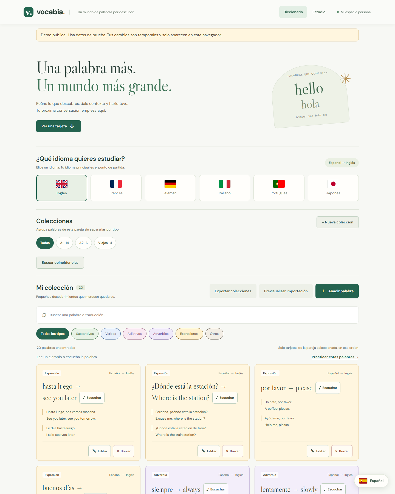
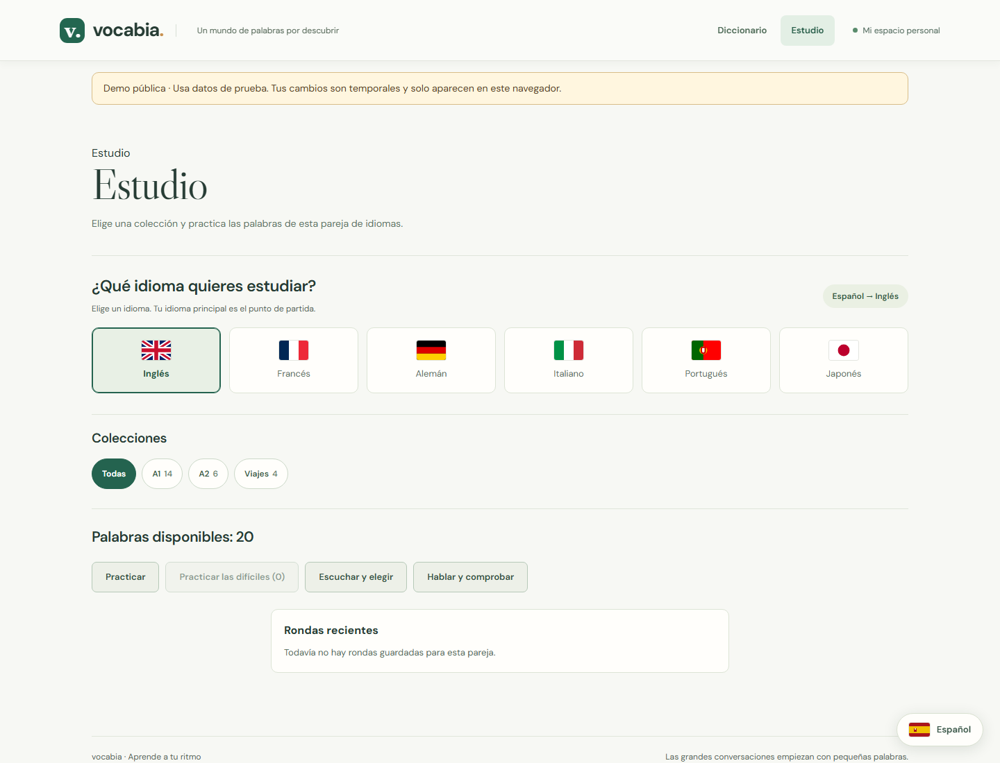

# Vocabia

**Un diccionario personal para guardar palabras y practicar idiomas.** Organiza vocabulario por pareja de idiomas y colecciones, añade contexto a cada tarjeta y repásalo con ejercicios escritos, de escucha y de pronunciación.

> **Estado:** beta funcional en local. La demo para visitantes está preparada, pero todavía no tiene una URL pública. El tutor con IA y la creación de tarjetas por voz quedan para una etapa futura.

## Índice

- [Una mirada a la aplicación](#una-mirada-a-la-aplicación)
- [Recorrido en un minuto](#recorrido-en-un-minuto)
- [Qué puedes hacer](#qué-puedes-hacer)
- [Probar la demo en tu equipo](#probar-la-demo-en-tu-equipo)
- [Instalar para desarrollar](#instalar-para-desarrollar)
- [Herramientas y decisiones](#herramientas-y-decisiones)
- [Comprobaciones](#comprobaciones)
- [Estado y límites](#estado-y-límites)

## Una mirada a la aplicación

### Diccionario

Elige la pareja de idiomas, explora las tarjetas y usa los filtros por tipo o colección. Cada tarjeta puede incluir traducción, ejemplos, notas y formas verbales.



### Estudio

Practica las palabras de la pareja y la colección seleccionadas. Puedes escribir la respuesta, escuchar y elegir una opción, o hablar y comprobar lo reconocido por el navegador.



Las capturas muestran la **demo local** en escritorio. La interfaz también se adapta a móvil.

## Recorrido en un minuto

1. En **Diccionario**, mira el idioma de referencia en el botón de la esquina inferior derecha y elige una bandera para estudiar otro idioma.
2. Pulsa **Ver una tarjeta** o baja hasta **Mi colección**. Lee un ejemplo y prueba **Escuchar** en una tarjeta.
3. Filtra por **Verbos** o entra en una colección como **A1**. Pulsa **Añadir palabra** si quieres crear una tarjeta de prueba.
4. Entra en **Estudio** desde la cabecera y elige **Practicar**, **Escuchar y elegir** o **Hablar y comprobar**.

En la demo, los cambios son temporales. Puedes experimentar sin alterar las tarjetas de otro visitante.

## Qué puedes hacer

- Crear, editar, borrar y buscar palabras o expresiones con traducción, idiomas, tipo, notas y uno o más ejemplos.
- Filtrar por pareja de idiomas, tipo de palabra y colecciones personalizadas.
- Guardar formas de verbos en inglés y escucharlas desde la tarjeta cuando estén disponibles.
- Importar y exportar colecciones en JSON. Antes de importar, puedes revisar qué entrará.
- Detectar tarjetas coincidentes y preparar una fusión de ejemplos, notas y formas verbales con vista previa y opción de deshacer.
- Practicar con ejercicios escritos, de escucha y de pronunciación. El progreso de estudio pertenece a la sesión local; no se incluye en las colecciones exportadas.

La interfaz está disponible en español, inglés, francés, alemán, italiano, portugués y japonés.

## Probar la demo en tu equipo

Descarga el proyecto desde [GitHub](https://github.com/SulimanHB/Vocabia) con **Code → Download ZIP** y descomprímelo, o clónalo con Git:

```powershell
git clone https://github.com/SulimanHB/Vocabia.git
cd Vocabia
```

Necesitas **Node.js 22.12 o posterior** y npm. Desde la carpeta del proyecto:

```powershell
npm ci
npm run build:demo
npm run start:demo
```

Abre [http://localhost:3001](http://localhost:3001). La demo incluye **40 tarjetas ficticias y 80 frases de ejemplo**: 20 tarjetas de español a inglés y cuatro para cada uno de los otros cinco idiomas de estudio. También trae las colecciones **A1**, **A2** y **Viajes**.

Cada navegador recibe una base temporal propia. Los cambios desaparecen tras 30 minutos sin actividad o al reiniciar el servidor. **Usa solo datos de prueba**: esta demo no tiene cuentas ni almacenamiento permanente.

## Instalar para desarrollar

Con las dependencias instaladas mediante `npm ci`, ejecuta:

```powershell
npm run dev
```

Abre [http://localhost:5173](http://localhost:5173). Este comando inicia el frontend y la API juntos. En este modo, los datos se guardan en `backend/data/`, carpeta excluida de Git. Puedes empezar añadiendo tu primera palabra desde **Diccionario**.

Si prefieres conectar un servidor PostgreSQL, copia la configuración de [backend/.env.example](backend/.env.example) a un archivo local `backend/.env` y ajusta la conexión. Nunca incluyas ese archivo ni contraseñas en un commit.

## Herramientas y decisiones

```text
Navegador (React)  →  API (Express)  →  Base de datos (PGlite o PostgreSQL)
```

La **API** es la parte del servidor que recibe peticiones del navegador: por ejemplo, pedir la lista de palabras o guardar una tarjeta. Esta separación permite que la interfaz y los datos evolucionen por separado.

| Herramienta | Para qué se usa | Por qué se eligió |
| --- | --- | --- |
| React | Construir la interfaz con componentes reutilizables. | Una tarjeta, un filtro o un formulario pueden tener su propia lógica y reutilizarse. |
| TypeScript | Dar tipos al frontend y al backend. | Ayuda a detectar errores como pasar un idioma donde se esperaba un identificador. |
| Vite | Servir y compilar el frontend. | Ofrece un arranque rápido y una configuración pequeña para esta aplicación React. |
| Node.js y Express | Exponer la API HTTP. | Permiten mantener el servidor en TypeScript y definir rutas sencillas para las palabras y colecciones. |
| Zod | Validar los datos recibidos por la API. | Una tarjeta incorrecta se rechaza antes de llegar a la base de datos. |
| PGlite / PostgreSQL | Guardar palabras, ejemplos y colecciones. | PGlite facilita el desarrollo local sin instalar un servidor; PostgreSQL permite usar un servidor de base de datos cuando haga falta. |
| Vitest, Testing Library y Supertest | Probar lógica, interfaz y rutas de la API. | Comprueban comportamientos reales, como crear una tarjeta o mostrar el resultado de un ejercicio. |
| ESLint y Git | Revisar el código y registrar sus cambios. | Ayudan a mantener el proyecto y a explicar su evolución en el repositorio. |

La estructura principal es `frontend/` para la interfaz, `backend/` para la API y los datos, y `docs/` para las capturas y el historial. Las decisiones y etapas anteriores están en la [guía de desarrollo](docs/historial-desarrollo.md).

## Comprobaciones

```powershell
npm test
npm run lint
npm run typecheck
npm run build
```

`npm test` ejecuta las pruebas del frontend y del backend. `lint` revisa reglas de código, `typecheck` comprueba los tipos sin generar archivos y `build` verifica que ambas partes compilan. Como comprobación opcional, `npm run test:postgres` usa Docker y un PostgreSQL temporal; no toca los datos de `backend/data/`.

## Estado y límites

- La demo todavía no está publicada en una URL; por ahora se ejecuta en local.
- No hay cuentas ni sincronización entre dispositivos. La demo se reinicia y el modo de desarrollo guarda los datos en el equipo.
- La voz depende de las funciones y voces disponibles en cada navegador; el reconocimiento de pronunciación puede fallar incluso cuando la palabra se diga bien.
- El tutor con IA y el dictado para crear tarjetas son ideas posteriores a esta beta.

[Ver el repositorio en GitHub](https://github.com/SulimanHB/Vocabia)
